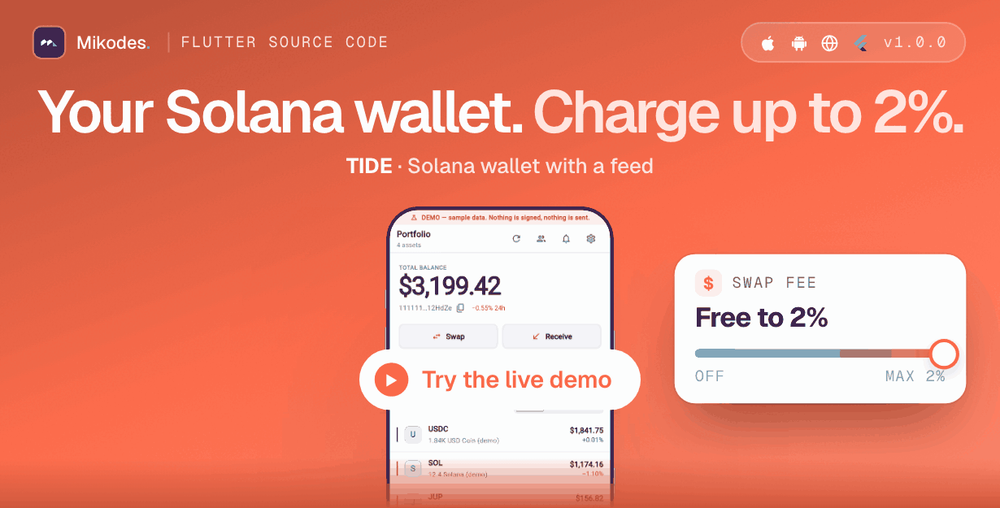
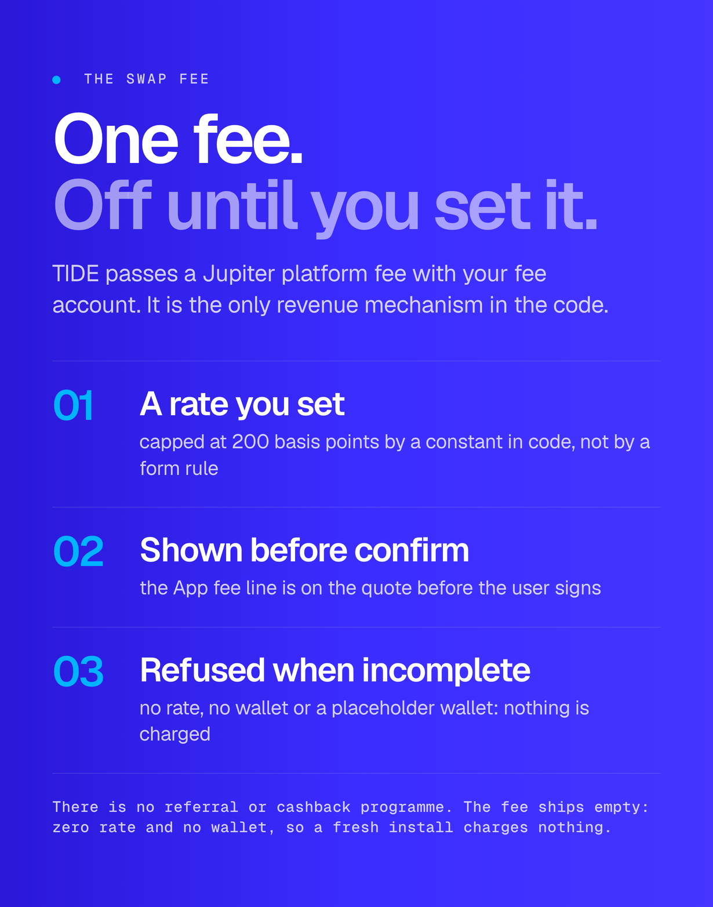
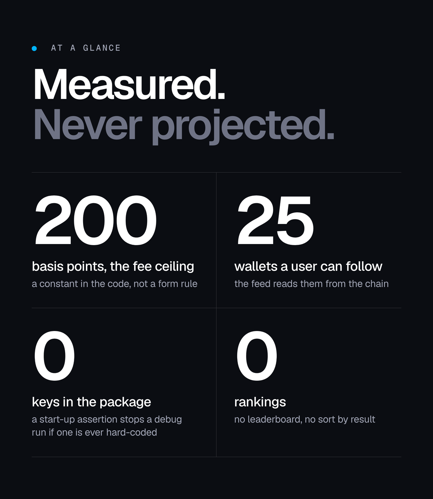
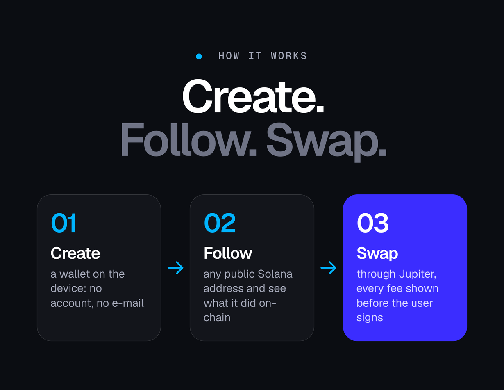
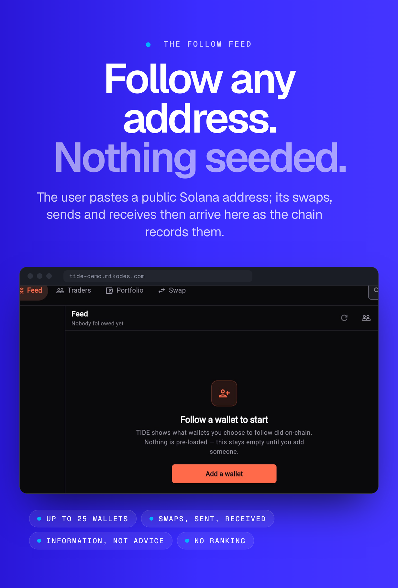
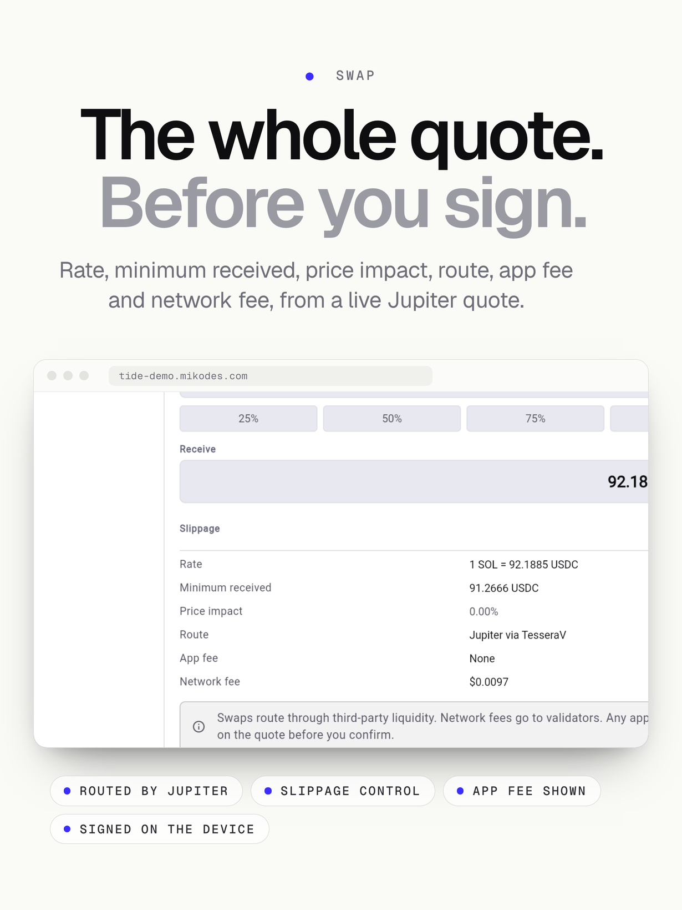
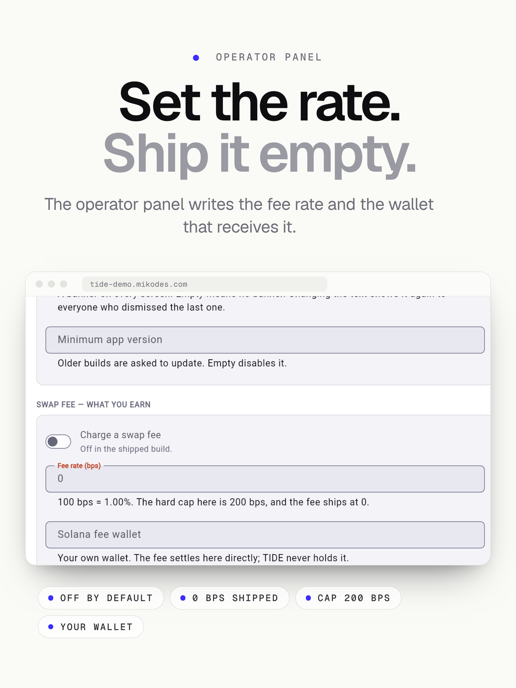

  

<h1 align="center">TIDE</h1>

  <b>Self-custodial Solana wallet with a social feed (Flutter).</b>

  <a href="https://tide-demo.mikodes.com/"><b>▶ Live demo</b></a> ·
  <a href="https://tide.mikodes.com/docs/"><b>Docs</b></a> ·
  <a href="https://tide.mikodes.com/"><b>Website</b></a> ·
  <a href="https://store.mikodes.com/p/tide/"><b>Get the full source code</b></a>

  
  
  

  

> **This repository is a showcase.** It holds screenshots, documentation pointers and a real excerpt
> from the code. The full application is sold as source code at
> **[store.mikodes.com/p/tide](https://store.mikodes.com/p/tide/)**: one payment, instant ZIP download, free setup help.

---

## What it is

A Solana wallet for iOS, Android and web with a built-in social feed, swaps, and a web build protected by a vault passphrase that is asked again before revealing keys or signing.

## Screens

 

 

 

## Features

- **Self-custodial Solana wallet**
- **Web build protected by a vault passphrase**
- **Token swaps**
- **Operator swap fee capped at 200 bps in code**
- **Copy execution as a separable module, off by default**
- **Copy execution gated on a self-declared region**
- **Feed reports observed on-chain activity, never advice**
- **No seeded data anywhere**
- **Ships keyless**
- **True light theme plus dark, warm coral accent**
- **Operator panel only in operator builds**
- **Optional realised tab, off by default and never ranked**

## A look at the code

**Fail-closed region gate**: [`snippets/jurisdiction_gate.dart`](snippets/jurisdiction_gate.dart). Copy execution is only enabled for a region the user has declared, and an unknown region is treated as restricted. The operator can add countries but can never remove the built-in baseline, so a bad configuration cannot switch the module on in a regulated market.

## Requirements (full version)

- Flutter SDK 3.41 or newer
- Xcode 15+ with CocoaPods, on a Mac
- Android Studio, current stable
- Google Chrome, current
- A Solana RPC endpoint of your own
- Apple Developer Program, enrolled as an organisation

Not included: Hosting and domain; Third-party API subscriptions; Developer accounts; Blockchain network fees; A backend — TIDE has none by design.

## Get the full source code

  

One payment, full licence, instant ZIP download and free setup help.
Questions: [mikodes.com/support](https://mikodes.com/support).

---

  Made by <a href="https://mikodes.com"><b>MIKODES</b></a> · <a href="https://github.com/Mikodesteam">more projects</a>

