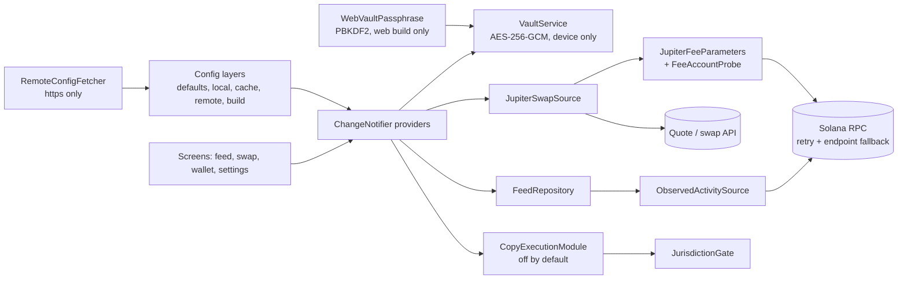

# How TIDE works

An engineering write-up of TIDE, a self-custodial Solana wallet with a "follow" feed, built with Flutter. It describes what the code does and why it is shaped that way. The full source is sold separately (link at the end); only a few excerpts are public.

## Reading order

If you only have five minutes: read "Key engineering decisions", then the three excerpts in [`../snippets/`](../snippets/). Each excerpt is a small, self-contained piece (a fee model, a region gate, a log redactor) and none of them is a working module on its own.

## The problem and who it is for

People who follow on-chain traders usually jump between a block explorer, a chat group and a wallet. TIDE puts those in one app: you follow public wallets, see what they did as plain observations, and swap in your own wallet. It is for operators who want to ship their own branded wallet app, and for developers who want to see how a non-custodial wallet, a swap fee and a regulated-feeling feature (copying trades) can be kept apart cleanly.

The design constraint that shapes almost everything: the app must be non-custodial, must ship with no keys or seeded data, and must stay on the "reports what happened" side of the line between information and advice.

## Architecture

Flutter, `provider` for state, no backend of its own. The app talks to a Solana RPC endpoint, a swap-quote API, a price API and, optionally, a single JSON file the operator hosts.

Folder layout (from `lib/core/`): `security` (vault, key derivation), `solana` (RPC, signing, tokens), `swap` and `monetization` (quote source, fee), `feed` and `standing` (observed activity, realised results), `compliance` (region gate, vocabulary), `copy` (the separable module), `config` (layers, flags, operator access) and `util` (decimals, log redaction).

The one structural rule: the file that holds secrets (`vault_service.dart`) has no network import. A private key is read inside the sign-and-send call, used, and dropped; it is never held in a field and never crosses a network boundary.

## One flow, step by step: a followed wallet swaps, you see it, you swap

1. **Follow.** The user adds a public wallet address to the watchlist (capped at 25 wallets). The feed is empty until this happens; nothing is seeded.
2. **Observe.** `ObservedActivitySource` asks the RPC for the wallet's most recent confirmed signatures (10 by default, because free RPC tiers are the constraint) and reads each transaction.
3. **Classify with arithmetic, not guesses.** The owner's token and lamport balance deltas across one transaction decide the kind: one asset down and another up is a swap, only up is a receive, only down is a send. There is no inference about intent.
4. **Say what could not be read.** The result carries `failure` (the read never happened) and `unreadable` (listed but not readable). The UI therefore never says "this wallet did nothing" on the strength of a request that failed.
5. **Render as an observation.** Feed strings are drawn from a vocabulary of past-tense verbs ("swapped", "detected"). A test scans every user-facing string on the feed surface for forbidden words.
6. **Swap.** From the swap screen, `JupiterSwapSource` asks for a quote. If the operator's fee is active, the quote carries `platformFeeBps` and the swap request carries a `feeAccount`; the two halves are built from one decision, so one is never sent without the other.
7. **Sign locally.** The wallet layer loads the key from the vault, signs the returned transaction, sends it once (no automatic retry for a send that may already have landed) and drops the key.

## Key engineering decisions

### 1. Config layers with visible origin

*Chosen:* the effective configuration is a merge of five layers, weakest to strongest: compiled defaults, the on-device operator panel, the last cached remote document, the remote document, and `--dart-define` values. The layer that supplied each value travels with it to the screen. *Alternative:* a single settings store. *Why:* an operator who changes a number and sees nothing move needs to be told that a hosted document is overriding it. A remote document can also lock the on-device panel entirely, so a value stored on one phone can never override what the operator publishes.

### 2. The fee is capped and empty by default, in code

*Chosen:* the swap fee ships disabled with no wallet, is clamped to 200 basis points in the parser, and only counts as active when a well-formed, non-placeholder wallet is set (see [`../snippets/swap_fee_cap.dart`](../snippets/swap_fee_cap.dart)). *Alternative:* trust the admin screen to validate. *Why:* values arrive from a remote file and from a local panel; validating in the model means no path can exceed the cap. The displayed fee is the fee actually sent, so the confirm sheet cannot disagree with the transaction.

### 3. Fee account is derived, probed, and waived when absent

*Chosen:* the operator configures an ordinary wallet; the app derives the associated token account for the swap's output mint, checks on chain that it exists, and quotes that swap with no fee if it does not. *Alternative:* pass the wallet straight through. *Why:* the swap API needs a token account rather than a wallet, and a fee account that does not exist makes the user's swap fail. A swap that earns nothing is better than a swap that fails. The reasoning is documented in the source next to the code (`jupiter_fee_parameters.dart`).

### 4. A feature that carries legal weight is a separable, fail-closed module

*Chosen:* copy execution lives in its own folders, has three independent switches that all default off (operator flag, per-rule "armed", and a one-time user confirmation), and is gated by a region the user declares. An unknown region counts as restricted, and the operator can add restricted countries but never remove the built-in baseline (see [`../snippets/jurisdiction_gate.dart`](../snippets/jurisdiction_gate.dart)). When it does run, every refusal has a readable reason (stale event, per-trade cap, daily cap, all-rules daily cap) and a copied trade is prepared as an ordinary swap the user confirms. *Alternative:* a single boolean. *Why:* alerting a user is different from placing a trade for them, and a silent no-op is indistinguishable from a bug.

### 5. Vocabulary as code

*Chosen:* three word lists (never permitted, permitted only alongside a "realised" marker, and advice words banned on observation surfaces) enforced by tests across the app's strings. Realised results are first-in-first-out arithmetic on two confirmed transactions; open positions are counted but not valued, and wallets are listed in follow order, never ranked. *Alternative:* a legal review and good intentions. *Why:* the difference between an observation and a recommendation is mostly tense and word choice, which a test can check on every build.

## Security and safety measures that exist in the code

- **Vault:** seed and per-chain keys are encrypted with AES-256-GCM under a key generated on the device; data that fails authentication raises a dedicated corruption error. Ciphertext has a version prefix, and unprefixed blobs are never decrypted.
- **Web build:** a browser has no keystore, so the user picks a passphrase. PBKDF2-HMAC-SHA256 with 600,000 iterations produces 64 bytes that are never stored: half seals the app's own vault key, half wraps the storage plugin's key. Only the salt, an IV and a verifier are persisted. The passphrase is asked again before the recovery phrase is shown and before every signature.
- **Keys from a proper RNG:** the mnemonic generator is handed an explicit CSPRNG source rather than relying on a package default whose byte range is slightly off.
- **Ships keyless:** `assertShipsKeyless()` runs at start-up, and tests run the same check, so a hard-coded RPC key fails the build. The RPC URL is treated as a credential.
- **Remote config is https only** with an 8-second timeout, so a fee wallet cannot be swapped on the network path.
- **Operator panel only in operator builds:** without a build-time passcode there is no panel, no route to it and no read of on-device panel values. The passcode has a minimum length, is held in memory only, and the docs state it is not what protects funds.
- **Log redaction at the boundary:** phrases, hex keys, addresses and signatures are masked before anything can reach a log or console (see [`../snippets/log_redactor.dart`](../snippets/log_redactor.dart)).
- **Bounded retries:** RPC calls retry with backoff and move to the next endpoint on rate limits or refusals, but a send is attempted once.
- **No seeded data:** a test asserts that feed, watchlist, ledger and profile start empty.

## Details worth a closer look

### Limits at a glance

Numbers that are fixed in code rather than left to configuration:

| Limit | Value | Where it applies |
|---|---|---|
| Swap fee ceiling | 200 bps (2.00%) | Parsed config, local or remote |
| Followed wallets | 25 | Watchlist |
| Signatures read per wallet per refresh | 10 | Observed-activity source |
| Copy rule per-trade ceiling | 1,000 (USD) | Copy rule sanitising |
| Copy rule daily ceiling | 5,000 (USD) | Per rule, and across all rules together |
| Copy slippage range | 0.1% to 5.0% | Copy rule sanitising |
| Maximum age of an observed event | 5 minutes | Copy evaluation |
| Web vault KDF | PBKDF2-HMAC-SHA256, 600,000 iterations | Web build |
| Minimum web passphrase length | 10 characters | Web build |
| Minimum operator passcode length | 6 characters | Operator builds |
| Remote config timeout | 8 seconds | Hosted JSON fetch |

### How a copy decision is evaluated

The copy module does not sign anything. `evaluate` returns an allow or a refusal, and it checks in a fixed order: is the module available at all (flag on and region permitted), is the rule armed and has the user confirmed the mode, is the observed event a swap, is the event neither too old nor stamped in the future, does the token sit on the user's allowlist, and do the per-trade, 24-hour and all-rules 24-hour caps hold. A chain that does not report a block time is refused too, because the age of the event cannot be known. Every refusal is an enum value with a sentence the user can read.

The decision is only the first gate. The copied trade appears as an ordinary swap labelled as prepared for the user, and the confirm step re-checks locks and caps before the wallet signs.

### Realised results without invented numbers

The optional "Realised" tab is off by default. When on, it matches sales to earlier purchases of the same token, first in first out, per token and per quote asset (SOL or a stablecoin). It then counts what it cannot price instead of hiding it:

- sales whose purchase happened before the readable window (they close nothing);
- swaps with no quote asset on either side (there is no honest denominator);
- purchases never sold in the window (counted, not valued).

Dust legs are ignored so a rent refund does not produce a nonsense ratio. Wallets are listed in the order the user followed them; there is no ranking code path.

### Retry policy for a free RPC tier

Public RPC endpoints rate-limit hard. The retry helper makes up to three attempts with a doubling delay, retries on rate limits and on "this endpoint refuses this caller" answers by moving to the next endpoint, and does not retry a method the endpoint will never serve. The send call passes a single attempt, because retrying a transaction that may already have landed is how users double-spend by accident.

### Demo mode that cannot leak into a release

A showcase build is switched on with a compile-time define that defaults to false, so the compiler folds the branch away in a normal build. A test asserts the default, a script inspects release bundles for demo markers, and the demo folder is not allowed to import the vault, the signer or the transaction code. Demo data is therefore a presentation layer, not a code path into a real wallet.

### Tests that hold promises

The test suite is organised around claims the product makes, not only around functions: the feed vocabulary test scans every user-facing string; a wiring test fails if a feature flag exists that no code reads (a switch that does nothing is worse than a missing feature); a theme test asserts a minimum contrast ratio in light and dark; a no-seeded-data test asserts empty starts; and a fee test pins the request shape, including that the fee is empty by default.

## How you would build something like this

1. **Start with the vault, not the UI.** Decide where the key lives on each platform (Keychain, Keystore, passphrase-derived on web), define one ciphertext format with a version prefix, and keep that module free of network code so you can prove it by inspection.
2. **Derive keys the standard way** (BIP-39 phrase, SLIP-10 for the chain's curve), cache the slow seed derivation in memory only, and test against known vectors.
3. **Build the read path next.** A chain reader with retry and endpoint fallback, plus a result type that separates "failed" from "empty" from "partial". Get that distinction right before you draw a feed.
4. **Add swaps through an aggregator**, and read the integrator-fee documentation closely: the parameters that look optional are where money is lost silently. Verify against the live API, then write tests that pin the exact request shape.
5. **Treat configuration as a product.** Layers, a remote document, a last-good cache, and a way to show where each value came from. Make every setting that matters ship in the safe position.
6. **Make regulated features separable and fail-closed**, and put the rules in testable code (limits, region, staleness) rather than prose.
7. **Write tests that guard the promises**: starts empty, ships keyless, every flag is read by some code, every user-facing string passes the vocabulary check.

## What this repository does not contain

The wallet, the swap path, the feed engine, the operator panel, the documentation set and the test suite are not published here. This write-up describes how they fit together so you can judge the engineering, or build your own along the same lines.

## Deployment and customization

- Builds for iOS, Android and web from one Flutter codebase (Flutter 3.41 or newer). The operator supplies their own RPC endpoint, optional hosted configuration URL and optional operator passcode as build-time defines.
- Branding goes through the theme files (light and dark, with a warm coral accent); the operator panel (or the hosted JSON it produces) sets the swap fee, the fee wallet, feature switches and the RPC endpoint.
- A demo mode exists for showcase builds, with labelled sample data kept out of normal builds.

Full source code, docs and setup help: https://store.mikodes.com/p/tide/
